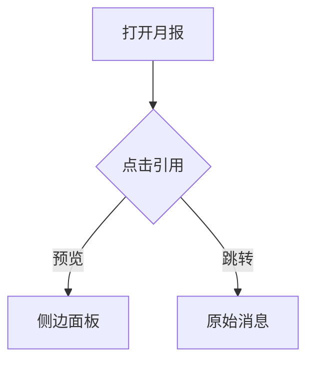
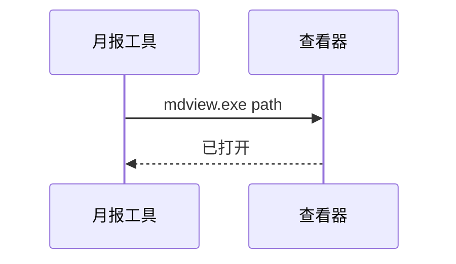

# 代码、公式与 Mermaid

```js
// JavaScript
const greet = (name) => `你好，${name}`;
console.log(greet('世界'));
```

```python
def fib(n: int) -> int:
    return n if n < 2 else fib(n - 1) + fib(n - 2)
```

```powershell
Get-ChildItem -Path "X:\示例归档" -Filter *.md | Measure-Object
```

```unknownlang
plain text for an unknown language <b>not bold</b>
```

```
no language, a very long line that should scroll horizontally instead of wrapping: 0123456789012345678901234567890123456789012345678901234567890123456789012345678901234567890123456789
```

~~~diff
- removed line
+ added line
~~~

## 数学

行内公式 $E = mc^2$，以及 $\sum_{i=1}^{n} i = \frac{n(n+1)}{2}$。

块级公式：

$$
\int_0^\infty e^{-x^2}\,dx = \frac{\sqrt{\pi}}{2}
$$

```math
\begin{aligned}
a &= b + c \\
d &= e \cdot f
\end{aligned}
```

货币不应被当成公式：价格 $5 到 $10 之间，余额 $ 100。

错误公式不应导致崩溃：$\frac{1}{$

## Mermaid





```mermaid
this is not valid mermaid syntax %%%
```
